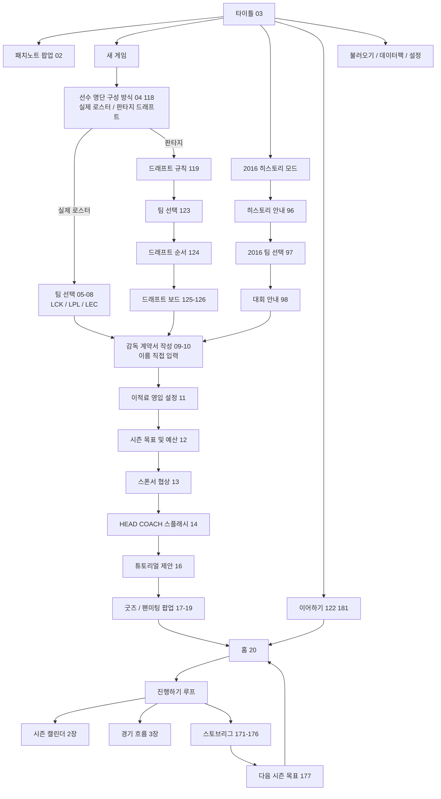
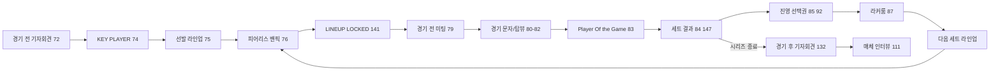

# LCK Manager 26 전체 화면 구조 지도 — LOL Manager v2 청사진

> 2026-11-18 오너 결정: 별도 히스토리 모드는 만들지 않고 프랜차이즈에 집중합니다. 아래 히스토리 관련 내용은 원작 조사 당시의 기록이며 현재 개발 계획이 아닙니다. 최신 결정은 `docs/HANDOFF.md`를 따릅니다.

작성: 2026-11-17 (Asia/Seoul)
대상 원작: [LCK Manager 26](https://pepper2.itch.io/lck-manager-26) (Pepper2, Alpha v8.28, 빌드 3091, Pepper Engine v0984)
우리 게임: 비상업 LOL Manager (소스 `/workspace/lol-manager`, 라이브 https://cancellawerra-bot.github.io/lol-manager/)

이 문서는 **원작을 직접 플레이한 화면(스크린샷 01–182)과 노트**를 기준으로, 우리 LOL Manager를 처음부터 다시 짤 때 쓸 구조 지도입니다. 라이브 사이트와 코드는 이 문서를 쓰는 동안 **수정하지 않았습니다.**

원작 문구·화면 배치·아트는 복제하지 않습니다. 원작 빌드에도 “무단 복제·수정·재배포 금지”가 명시되어 있습니다. 아래는 **기능 개념과 흐름만** 정리한 것이며, v2의 화면, 문구, 연출은 독자적으로 디자인해야 합니다.

### 출처
- 플레이 노트: `/workspace/lolmanager-research/play/NOTES.md`
- 스크린샷: `/workspace/lolmanager-research/play/01-itch-page.png` ~ `203-2017-roster-gutted-military.png` (라벨은 핵심 화면과 Phase 4 노트를 확인)
- 1단계 벤치마크: `/workspace/lolmanager-research/REPORT.md`
- 시즌 카드 데이터: `/workspace/lolmanager-research/SEASON_CARDS.md` (2012–2026 LCK, 10경기 이상 **1,011장**, 연봉 공식)

### 플레이 범위와 아직 못 본 화면
Phase 4(샷 183–203)까지 플레이를 마쳤습니다. 히스토리는 2016 스프링 승강전·서머·월즈 2016·2017 개막을 통과했고, 스토브의 주간 입찰 결과 화면도 확인했습니다. 아래는 **아직 화면에 직접 못 본 것**입니다.

| 항목 | 상태 | 비고 |
|---|---|---|
| 히스토리 **강등 시 게임 오버** | 안내만 확인 (96) | 2016 스프링 승강전에서 스베누가 패자조 결승을 이겨 잔류(185, 소식). 패자조 결승 패배 연출은 못 봄 |
| 2016 **MSI·월즈 우승 스플래시** | 미관찰 | 그룹 스테이지 화면(186, 187)까지 확인. 미참가(스베누)라 시뮬로 넘어가 우승 스플래시는 못 찍음. 2026과 같음 |
| **우리 팀의 영입 성공** | 미관찰 | 트라이아웃·스토브 입찰 결과 화면(193, 199)은 확인. 이번 런의 제안은 모두 거절됨(“강팀·구단 명성 우선”) |
| 아시안게임 **메달·병역 면제 결과** | 부분 확인 | 선발·조편성·시작(157–159)까지. 같은 날 자동 시뮬로 끝나 메달 스플래시는 못 찍음 |
| 참가하지 않은 **2026 MSI·EWC·월즈 우승 스플래시** | 부분 확인 | 미참가 시 루프가 스킵하거나 관전만 하고 넘어감 |

---

## 1. 전체 화면 지도

### 1-1. 시작 흐름 (타이틀 → 첫 홈)

원작의 새 게임은 **감독 이름을 계약서에 직접 쓰는 것부터** 시작합니다. 미리 정해진 감독이 먼저 나오지 않습니다.

| 순서 | 화면 | 정확한 라벨·요지 | 샷 |
|---:|---|---|---|
| 0 | itch.io 페이지 | 무료 HTML5, 팬메이드, Riot·LCK와 무관 | 01 |
| 1 | 패치노트 팝업 | 「LCK 매니저 신규 버전이 업데이트됐습니다 (11/15) Alpha 8.28v」. 히스토리 로스터팩 안내, 「다음부터 보지 않기」, 「확인」 | 02, 152 |
| 2 | **타이틀** | 「LCK MANAGER 26 \| LoL ESPORTS MANAGER FAN MADE」. 카드: **새 게임**(원하는 팀을 골라 역사를 만들어보세요!), **2016 히스토리 모드**(2016 LCK부터 다시 쓰는 이스포츠의 역사 — 당신이 주인공입니다.), **이어하기**(저장된 게임이 없으면 “저장된 게임이 없습니다”). 「온라인 모드 'LCK: FLIP' 개발 중!」. 하단: 불러오기, 데이터팩(지금 적용된 데이터팩 없음), 설정, Alpha v8.28 패치노트, Be a Pro 배너. 고지: “본 게임은 수익을 창출하지 않는 무료 팬 메이드 게임이며, Riot Games와 무관한 비상업 프로젝트입니다.” 우상단: 데이터팩, 디스코드, KO/EN | 03, 95 |
| 3 | 모드 선택 | 「NEW CAREER · 2026 LCK」 / **「선수 명단 구성 방식을 선택해주세요」**. 두 장: **REAL ROSTER · 실제 로스터**(현실과 동일한 로스터로 게임을 시작합니다) / **FANTASY DRAFT · 판타지 드래프트**(LCK 선수들을 전원 드래프트로 선발, 완전히 새로운 방식의 로스터가 구성됩니다). 「← 처음으로」, 「다음 F」. *히스토리 모드는 이 화면이 아니라 타이틀의 별도 카드에서 들어갑니다. 원작에 ‘신규 구단 창단’ 선택지는 없습니다.* | 04, 118 |
| 3b | 판타지 규칙 팝업 | 「판타지 드래프트 진행 방식」. ① 팀 고르기 ② 드래프트 순서 정하기(무작위, **3번까지 다시 섞기**) ③ 주전 드래프트 · 5라운드(지그재그 1→10, 10→1, 포지션마다 한 명) ④ 추가 한 바퀴(10→1, 6번째 픽). 미지명 선수는 FA. 2군(CL)은 그대로 남음. 「← 돌아가기」, 「팀 고르기 F」 | 119 |
| 4 | 팀 선택 | 「어느 팀을 맡으시겠습니까」. 부제: 밴픽을 하고, 경기를 지휘하고, 이적 시장에서 로스터를 만듭니다. 팀을 고르면 감독 계약서로 넘어갑니다. 리그 탭: **LCK 10개 구단**(케스파컵 → LCK컵 → 정규 → Road to MSI → 플레이오프), **LPL 14개 구단**, **LEC 10개 구단**. 목록: 팀 전력, 시즌 예산(억). 우측 카드: 주전 라인업과 OVR, 주전 평균 나이, 「○의 감독이 된다 F」 | 05–08, 123(판타지) |
| 4b | 판타지 전용 | 「FANTASY DRAFT · 2026 LCK」 팀 선택(선발 예산 **16억** 캡) → 「드래프트 순서」(내 픽 번호, ↻ 순서 다시 섞기 N번 남음, 팀마다 5명 또는 6명 선발, 「드래프트 시작 F」) → 드래프트 보드(「N라운드 · M번째 픽」, 포지션 필터, OVR·나이·연봉, 「이번 픽 최대 12.5억」, 「이번 픽 맡기기 / 남은 드래프트 모두 맡기기」, 다른 팀 로스터 탭) | 123–126 |
| 5 | **감독 계약서 작성** | 「NEW CAREER」 / 「감독 계약서 작성」. “○의 새로운 감독님, 환영합니다. 계약서 서명에 앞서 아래 항목을 작성해주세요.” **이름(직접 입력)**, 생년월일, 국적(한국/중국/베트남/미국/유럽), 사진(선택). 경력 4종: **비선수 출신 / 전 프로 2군 출신 / 전 프로 1군 출신 / 전 월드 우승자 출신**(시작 능력 범위에 영향). 좌측 서명란(「여기에 서명해 주세요」, 「다시 쓰기」). 「뒤로」, 「프로필 확정 F」. *빈 화면에서는 이름이 ‘이름 없음’이고, 확정 버튼이 비활성입니다.* | 09, 10 |
| 6 | 이적료 영입 설정 (팝업) | 「이적료 영입 설정」 / “계약 중인 선수를 이적료로 사고파는 기능을 사용할까요?” **켜기**: 스토브리그에 다른 구단 선수에게 이적 제안을 할 수 있고, 다른 구단도 우리 선수에게 보냅니다. **끄기**: 지금부터 계약이 끝난 FA만 영입, 계약 기간 중 우리 선수는 떠나지 않습니다. 「끄기」 / 「켜기」. 배경은 다음 화면(시즌 목표) | 11 |
| 7 | **시즌 목표 및 예산 설정** | 「SEASON GOAL & BUDGET · 연도」 / 「시즌 목표 및 예산 설정」. 구단주가 목표를 제안(예: “올해는 **8위 이내**까지는 가 주셔야 합니다”). **구단주 신뢰도**와 달성/미달 시 예상치. 목표 티어(플레이오프 진출 / 8위 이내 등)마다 **예산 외 지급액 · 달성 보너스 · 실패 시 신뢰도 삭감**. 추가 목표: LCK컵 or 케스파컵 4강, 국제대회 진출, 라이벌 상대 전적 우위. **코칭 스태프 유지/교체**(수석코치, 코치, 2군 감독). **CL(2군) 육성 투자**(거의 절제 / 표준 / 공격적). 우측 **시즌 장부**(수입: 지난 시즌 잔액, 스폰서, 구단주 지원금, 멤버십 등 / 지출: 선수 연봉, CL 육성비, 스카우터, 코칭). 「확정하고 시즌 시작 F」. 시즌 2(2027)에도 같은 화면이 다시 나옵니다 | 12, 99(히스토리), 127(판타지), 177(시즌2) |
| 8 | 스폰서 협상 | 「SPONSORSHIP」 / 「스폰서 협상」. “구단 명성 N → 스폰서 칸 1개. 큰 회사는 메인으로만, 작은 회사는 서브로만 제안합니다.” 후보 카드(연 금액, 목표, 달성 시 보너스, 도전형/메인/현금형, 계약 연수). 우측에서 기간·조건(그대로/기본급/보너스) 협상, 수락 확률. 「이번 칸은 비워 둔다」 / 「이 조건으로 계약」 | 13, 100 |
| 9 | HEAD COACH 스플래시 | 감독 부임 연출 | 14, 101, 139 |
| 10 | 대회 개막 스플래시 | 예: KeSPA CUP “새 시즌의 첫 번째 대회” | 15, 178 |
| 11 | 튜토리얼 제안 | 「수석코치 ○○입니다, 감독님」. “부임 첫날이시죠. 구단 돌아가는 것부터 첫 경기까지, 제가 옆에서 하나씩 안내해 드릴까요?” 「아니요, 바로 시작」 / 「안내 받기」. 안내를 받으면 홈에서 「TUTORIAL」 안내 카드가 겹쳐 나옵니다(예: 걸음 1/12, 「진행하기」 버튼 강조, 「다음 F」) | 16, 102–107 |
| 12 | 굿즈·팬미팅 팝업 | 시즌 유니폼/자켓 제작량·광고 모델, 올해 팬미팅 여부(시기·장소). 「나중에」 / 확정 | 17–19, 113, 134, 138, 176, 179 |
| 13 | **홈 대시보드** | 주 단위 운영의 중심. 「진행하기 F」, 다음 경기, 오늘 할 일, 재정, 이번 주 스케줄, 대회 대진, 여론, 받은 소식, 시즌 목표, 수석코치 보고. 상단 경고 예: 「주전 일정 빈 칸 N개 — 채워야 진행됩니다 선수단 일정 >」 | 20, 108, 146 |

이어하기는 타이틀의 「이어하기」 또는 저장 슬롯 선택(122, 181)으로 들어갑니다. 슬롯은 모드별로 하나씩 보입니다(예: 일반 · 한진 브리온 2027 KeSPA / 히스토리 · 스베누 2016 KeSPA). 마지막으로 불러온 슬롯의 모드를 따릅니다.

### 1-2. 시작·시즌 흐름 (도식)

### 1-3. 사이드바 메뉴와 하위 탭

홈 이후 왼쪽 고정 사이드바(20 등에서 확인). 위쪽은 구단명·시즌, 큰 버튼 **「진행하기 F」**. 아래쪽 트로피 카운터 **「LCK n회 / 월즈 n회」**.

대회가 열리면 해당 대진 메뉴가 사이드바에 **임시로 추가**됩니다(케스파컵 대진, LCK컵 대진, EWC 대진, 데마시아컵 대진, 월즈 대진).

| 메뉴 | 하위 탭 | 요지 | 샷 |
|---|---|---|---|
| **홈** | — | 대시보드. 재정 칩(보유 자금, 시즌 말 예상, 팬미팅, 상태), 시즌 목표, 수석코치 보고, 여론, 오늘 할 일 | 20, 108, 146 |
| **소식** | 소식 / 커뮤니티. 필터: 전체 / 우리 팀. 「안 읽음」, 「모두 읽음」 | 뉴스 피드(구단·대회 소식). 우측 상세 + 현재 순위 요약 | 21, 60 |
| **오피스** | **프로필** / **구직센터** / **즐겨찾기** | 프로필: 감독 이름·경력, 구단주 신뢰, 팬심, 시즌 목표, 자금 수지, **트로피 캐비닛**, 능력·업적, 통산 우승, 시즌 연표. 구직센터: “제안은 스토브리그에만 들어옵니다”(170) | 22, 58, 59, 170 |
| **구단** (MY TEAM) | **개요** / **선수 기록** / **챔피언** / **일정/결과** / **선수단 일정** / **예산** / **연혁** | 개요: 코칭 스태프, 1군·CL 로스터(OVR, 라인전·한타·피지컬·운영, 컨디션, 계약), 스폰서, 트로피, 유니폼·자켓, 다음 경기. 선수단 일정은 진행 조건(빈 칸을 채워야 함) | 23, 29–33, 34, 41, 61, 109, 117 |
| **마케팅** | **개요** / **굿즈** / **팬미팅** / **홈스탠드** / **지난 기록** | 팬심, 구단 인기, 시즌 수익 장부(시즌 유니폼·자켓, 월즈 유니폼, 우승 기념, 경기 뒤 무료 팬미팅, 대형 팬미팅, 홈스탠드, 멤버십) | 24–28 |
| **LCK** | **순위/일정** / **팀별 로스터** / **CL** / **해외 리그** | 주차별 순위·일정, 2026 시즌 LCK 로스터 현황(전력 합, 감독·코치), CL 리그, 해외 리그 | 43, 55–57, 116 |
| **기록** | **리더보드** / **기록실** / **패치 노트** / **메타** | 대회별 리더보드, 명예의 전당(기록실), 패치노트, 챔피언 메타 | 44, 52–54 |
| **영입** | **FA** / **스카우팅** / **솔로랭크** / **트라이아웃** / **선수 검색** / **루머** | 시즌 중에도 열리지만, 계약 선수 이적·FA 제안의 본게임은 스토브리그 | 45–50, 94, 169, 171–175 |
| **문제 신고** | — | 버그 리포트 | 93 |
| **설정** | 화면 / 소리 / 경기 관전 / 인게임 환경 / 저장·데이터 | 아래 1-5 | 35–41, 128, 137, 180 |
| **디스코드** | — | 외부 링크 | 03, 20 |

선수 카드는 구단·검색·영입에서 열립니다. 앞면은 수집형 카드(OVR, 이름, 포지션, 소속, 트로피), “카드를 누르면 뒷면이 나옵니다”(51). 프로필 탭: 프로필, 상세 기록, 성장, 트로피룸, **면담**(62–66).

### 1-4. 주요 팝업·오버레이 (홈 루프 안)

| 팝업 | 라벨·요지 | 샷 |
|---|---|---|
| 주전 일정 미작성 | 「주전 일정 빈 칸 N개 — 채워야 진행됩니다」 | 20, 34, 182 |
| 굿즈 만들기 | 「굿즈 만들기 · 연도 시즌」 / “2026 시즌 유니폼 제작량을 정해주세요.” 제작 X / 소량 0.3억 / 보통 0.6억 / 많이 1.2억 / 대량 2.4억, 광고 모델(인기도 배율), 예상 손익 | 17, 18, 176 |
| 굿즈 추가 생산 | 「추가 생산 · 2026 시즌」 “모두 팔렸습니다. 추가로 만들까요? — 2주 뒤에 들어오고, 제작비가 20% 더 듭니다.” 제작 X / 소량 / 보통 | 148 |
| 굿즈 판매 정산 | 「굿즈 판매 끝 · 2026 시즌」 제작비 / 판매 수익(판매율) / 남은 재고 정리(원가의 20%) / 순이익 | 156 |
| 팬미팅 | 「대형 팬미팅 · 연도」 “올해 팬미팅을 열까요?” 시기: 여름 휴식기(MSI 기간, 우리가 MSI에 없을 때만) 또는 12월 스토브리그. 장소: 소극장 0.25억 / 공연장 0.6억 / 체육관 1.2억. 「나중에」 / 「올해는 열지 않음」(또는 「올해는 열지 않음」) / 「열기」 | 19, 113, 179 |
| 마케팅 결정 | 시즌 중 굿즈 관련 결정 | 134, 138 |
| 은퇴 선언 | 시즌 전환 시 “은퇴 선언 N명” | 178 |
| 패치노트 | 타이틀 또는 설정에서. 「다음부터 보지 않기」 | 02, 152 |

### 1-5. 설정

설정은 모달(35). 좌측 탭 + 하단 「튜토리얼 다시 보기」, 「기본값으로」, 「게임 시작 화면으로」(나가기, 자동 저장).

| 탭 | 항목 | 샷 |
|---|---|---|
| **화면** | 언어 한국어 / English. 표시 방식 창 모드 / 전체화면. 화면 배율 100–130%. 월즈 테마(밝은 크림 / 어두운 크림 / 기본 테마) | 35 |
| **소리** | 음량 등 | 36 |
| **경기 관전** | 문자/탑뷰, 매치엔진 관련 | 37 |
| **인게임 환경** | **이적 시장 빈도** 적음 / 보통 / 활발함(“AI 구단이 얼마나 자주 선수를 사고파는지”). 능력치 수정: 챔피언 / 선수 / 코치 — 열기 / 기본값 | 38, 40, 137 |
| **저장·데이터** | 파일로 저장 / 파일 불러오기, 코드로 내보내기 / 코드로 불러오기. 데이터팩, 로스터팩, 히스토리 로스터팩(모드 훅, 최대 3개) | 39, 128, 180 |

저장은 브라우저(localStorage·IndexedDB) + 파일/코드 백업. 자동 저장 단위가 거칠어, 탭을 잃으면 중간 주가 되돌아갈 수 있습니다(노트).

### 1-6. 화면 번호 총람 (01–203)

시작·타이틀 01–16, 19–20. 굿즈·팬미팅 17–19, 113, 134, 138, 148, 156, 176, 179. 홈·사이드바 20–60, 93. 면담·재계약 61–68, 164–166, 194. 케스파·경기 흐름 69–89, 110–115, 121, 129–133, 135–136, 141–142, 147, 182–183. LCK컵·국제 90–92, 140, 143–146, 149–151, 153–155, 157–168. 히스토리 96–117, 182–188, 200–203. 판타지 118–127. 이어하기·설정 95, 122, 128, 137, 180–181. 스토브·시즌2·트라이아웃 169–179, 189–203.

---

## 2. 시즌 캘린더와 대회 형식

확인한 일정은 **일반 모드 2026 → 2027 전환** 기준입니다. 히스토리 2016의 스프링 이후(승강전·서머·월즈·2017)는 5-2장에 정리했습니다.

### 2-1. 2026 일반 모드에서 확인한 달력

| 시기 (확인한 날짜) | 대회·국면 | 형식 (화면에 나온 대로) | 샷 |
|---|---|---|---|
| 1/1~ | **KeSPA CUP** | 시즌 첫 대회. 대진 추첨(69–70) 후 토너먼트. 결승 미리보기 「결승 시뮬 F」(135). 우승 스플래시 후 휴식기 | 15, 42, 69–71, 89, 112, 135–136 |
| ~2월 (결승 약 2/27) | **LCK CUP** | 그룹 드래프트(바론 그룹 / 장로 그룹). “지난 시즌 우승 팀이 바론, 준우승 팀이 장로 그룹의 첫 자리”. 조별 1R–5R → **플레이-인** → 플레이오프 → 결승. 사이드바 「LCK컵 대진」 | 90–91, 140, 143 |
| 직후 휴식기 | LCK컵 우승 스플래시 | 「LCK CUP 2026 · CHAMPION … 두 팀이 퍼스트 스탠드(첫 국제전)에 진출」 | 143 |
| 3/16–3/22 | **퍼스트 스탠드** | 국제전. 대회 MVP(선수, POG 수, KDA). 버튼 「정규 시즌 시작 F」 | 144 |
| 3/30 | 정규 시즌 개막 | 「2026 · OPENING LCK SEASON」 | 145 |
| 1주차 3/30 – 9주차 5/31 | **정규 시즌 전반** | 10팀 순위, 플레이오프 라인은 5위. 시즌 목표(예: 8위 이내)가 홈에 표시 | 146 |
| 정규 중반 (대략 6–8주차) | **EWC 선발전** | 더블 엘리미네이션(승자조 1라운드, 패자조 1라운드) | 149 |
| 5/31 후 휴식기, 6/6–6/14 | **Road to MSI** | 1위 vs 2위 **1시드 결정전 BO5**, 패자 vs 3위 **최종전**. 선발 라인업·피어리스 밴픽 | 150–151 |
| 6/28–7/12 | **MSI** | 미진출 시 빠르게 시뮬. 이번 런에서 우승 스플래시는 못 찍음 | 노트 |
| 7/15–7/19 | **EWC 2026 녹아웃 (PARIS)** | 조는 GSL(첫 경기 BO1, 승자전 BO1, 패자전 BO3, 최종전 BO3). 녹아웃: 8강 BO3 → 4강 BO3 → 결승 BO5 + 3·4위전 BO3. LCK/LPL/LEC/LCS/LCP. 미참가 시 “결과는 계속 볼 수 있고, 8강부터는 관전할 수 있습니다.” 「다음 경기 진행 F」 / 「관전」 | 153 |
| 7/27 10주차 – 8/24 14주차 | **정규 시즌 후반** | 후반은 **LEGEND 그룹**(상위 5팀 · 전적 이월) / **RISE 그룹**(하위 5팀 · 전적 이월)으로 나뉨 | 155 |
| 8/26~ | **LCK 플레이오프** | 더블 엘리미네이션(승자조 4강 등) | 노트 |
| 정규 종료 후 | **2026 LCK · SEASON FINALE** | 우승 팀, ★ SEASON MVP(POG·KDA), 킬/어시스트/KDA 1위. 버튼 「아시안게임으로 → F」 | 154 |
| 결승 후 휴식기 | 아시안게임 카운트다운 | 홈에 「D-N 아시안게임 개막까지」, 경기 준비 n/3. LEGEND/RISE 최종 순위 | 155 |
| 9/29–10/2 | **아시안게임** (2026 아이치·나고야) | 8개국 · 48명, 나라마다 6명(주전 5+1). STEP1 선발 6인 → STEP2 조별리그(두 조, 각 조 2팀 진출) → 4강 → 결승 → 시상(**금메달은 병역 면제**). 협회가 대표팀 감독을 제안(“보수 없습니다. 명예뿐입니다. 맡아도 소속 구단 일은 그대로 하십니다.”) 「맡는다」 / 「고사한다」 | 157–159 |
| 10/3–10/15 | **DEMACIA CUP 2026** | 월즈가 아님. 정규 상위 팀 초청(여섯 리그 12팀). 스위스(R1 BO1, 이후 BO3, 같은 리그 1R 회피) → 8강 10/10–11 → 4강 10/12–13 → 결승 10/15. 사이드바 「데마시아컵 대진」 | 160–161 |
| 10/16~11/15 | **WORLD CHAMPIONSHIP 2026** | 「19개 팀이 확정됐습니다. 마지막 4팀은 플레이-인부터 시작합니다.」 LCK 시드 4는 **플레이오프 성적**. 플레이-인(4팀, 1자리, 더블 엘리미 BO5) → 스위스(16팀 · 8팀 진출, R1/5) → 녹아웃 8강 → 우승 「THE THRONE」. 크림/레드 테마, 사이드바 「월즈 대진」. 미진출 시 “이번 월즈는 관전으로 지켜봅니다” | 162–163, 167 |
| 월즈 결승 전 | 재계약 결정 | “계약은 스토브리그 전날 끝납니다. 결승 전에 연장 협상 또는 내보내기 예약을 모두 정해야 결승으로 넘어갑니다.” CL 신인은 내보내면 은퇴, 「2군 감독에게 일임」 | 164–166 |
| 월즈 결승 후 | **LCK AWARDS · 시즌 결산 시상식** | ALL-Pro First / Second(포지션별 핵심 스탯 + LCK 순위). 「다음 F」로 후속 시상 | 168 |
| 11/16~약 11/29 | **트라이아웃 WEEK 1+** | 스카우터를 어느 경기로 보낼지 정함 | 169 |
| 11/30–12/28+ | **스토브리그** | FA 밀봉 입찰, 이적료 2단계, 루머, 선수 검색, 구직센터 제안, 다음 시즌 자켓 제작 | 170–176 |
| 다음 해 1/1 | **시즌 2** | 다시 시즌 목표·예산(2027) → KeSPA CUP 2027. 은퇴 팝업, 타 구단 감독 선임 뉴스. 달력은 2026과 같은 고리로 반복 | 177–179 |

우리 팀이 탈락한 대회는 날짜가 빠르게 시뮬됩니다. 우리 시리즈는 「즉시 결과」로도 세트당 약 30–60초가 걸립니다(POG·기자회견 포함).

### 2-2. 대회 형식 메모

- **피어리스**는 컵·플레이-인·Road to MSI·월즈 등 시리즈 경기에 적용됩니다. 문구: 「피어리스 드래프트: 이번 시리즈에서 한 번 사용한 챔피언은 픽할 수 없습니다」(140, 76).
- **2026 첫 번째 선택권**(진영 선택권): 세트 후 진 쪽이 다음 세트의 진영 또는 픽 순서를 고릅니다(3장).
- 게임은 일부 대회를 가공 명칭으로 둡니다. 퍼스트 스탠드·MSI·EWC·아시안게임은 유지하고, **데마시아컵**은 월즈와 **별도** 초청 대회입니다. 사이드바 트로피는 그래도 「월즈 n회」로 셉니다.
- 해외 리그(LPL·LEC 등)는 팀 선택과 「LCK > 해외 리그」에서 보이며, 스토브에서는 이적·감독 이직 대상이 됩니다. 해외로 옮기면 그 리그가 내 리그가 됩니다(170).

---

## 3. 경기 흐름

한 시리즈는 아래 순서로 이어집니다. 케스파·LCK컵·정규·Road to MSI·히스토리 모두 같은 뼈대입니다(182에서도 라인업 → 라이브 → POG).

| 단계 | 화면 라벨·조작 | 샷 |
|---|---|---|
| 1. 경기 전 기자회견 | 「PRESS CONFERENCE 경기 전 기자회견」. 참석 기자 여러 명, 질문 1/N. 답변 톤: **적극적 / 열정적 / 신중 / 절약**(또는 절제) + 노코멘트(“답하지 않는다”). 「수석코치에게 맡기기」. 결과 오버레이 「회견 종료」(사기 / 팬심 / 구단주 신뢰도 / 상대 사기 / 감독 신뢰 증감) | 72–73, 110, 129 |
| 2. KEY PLAYER | 양 팀 핵심 선수 맞대결(포지션, OVR, KDA·승률은 시즌 초엔 비어 있음), POINT PICKS, 「밴픽으로 ▶ F」 | 74 |
| 3. 선발 라인업 | 「선발 라인업 · N세트」. 포지션별 교체, 우리 컨디션 표시, 상대 컨디션은 숨김. 우리 전력 vs 상대 전력. 「선발 라인업 확정 F」. “같은 포지션 벤치 선수와만 교체할 수 있습니다…” | 75, 86, 150 |
| 4. 밴픽 (피어리스) | 보드 중앙 챔피언 그리드, 필터(F / 역할 / 메타 등), 「수석코치에게 맡기기 F」, 「수석코치 조언 / 코치 추천」 배지. BAN LIST. 하단: “아직 판단하기 이릅니다 / 조합” | 76–78, 107, 140, 151 |
| 5. LINEUP LOCKED | 수석코치 총평(조합 태그 예: “이니시+누킹 확보”, “탱커 0 · 앞이 얇음”). 「경기 전 미팅 F」 | 78, 115, 141 |
| 6. 경기 전 미팅 | 「PRE-MATCH MEETING 경기 전 미팅」. 상대 감독 성향(예: 공격적 한타를 선호). 수석코치 조언. 작전 3종: **공격 / 균형 / 안전**(또는 수석코치가 제안하는 공격·균형·안전). 「수석코치에게 맡기기 F」 | 79 |
| 7. 라이브 경기 | 문자 중계 또는 탑뷰(미니맵). 골드·오브젝트(드래곤/전령/바론 등), 라인 주도권, KDA·CS·DPM. 「코치 보이스」는 세트당 1회. 하단: 일시정지, 텍스트/하이라이트, 속도, 「즉시 결과 F」, 사운드, 선수 정보, 골드 흐름, 라인 주도권 | 80–82, 149 |
| 8. POG | 「Player Of the Game」 카드(OVR, 챔피언, KDA, KP, TC, 평점, 해설 코멘트). 「확인 F」 | 83, 130, 142, 182 |
| 9. 세트 결과 | 포지션별 K/D/A와 TC / GSR / DPM / VC, **골드 흐름** 그래프, 오브젝트 타임라인(드래곤 / 유충·전령 / 바론·장로 / 포탑·억제기), BAN LIST. “다음 2세트 진영 선택으로 갑니다. 고른 뒤 라커룸으로 이어집니다.” 「계속 F」. 마지막 세트는 “다음 시리즈가 끝납니다. 기자회견으로 넘어갑니다.” | 84, 131, 147 |
| 10. 진영 선택권 | 「진영 선택권 · N세트」. **2026 첫 번째 선택권**: 진 팀이 진영(블루/레드) 또는 픽 순서(선픽/후픽) 중 하나를 고르고, 상대가 나머지를 고릅니다. 네 칸: ① 블루 진영(탑 인근 아래) ② 레드 진영(탑 오른쪽 위) ③ 선픽(밴픽 첫 픽) ④ 후픽(마지막 픽/카운터). 상대가 이미 진영을 고른 뒤에는 선픽/후픽만 남습니다(92). 「하나를 고르세요」, 「수석코치에게 맡기기」, 「확인 F」. 결과 화면(121) | 85, 92, 121 |
| 11. 라커룸 | 「라커룸 · N세트 시작 전」. 직전 세트 폼, 직전 세트 / 시리즈 누적 평점. 메시지: 대상 **팀 전체 / 개인**, 말투 **침착 / 단호 / 강하게**, 한두 가지 문장 선택. 「수석코치에게 맡긴다 F」. 반응 화면(88, 114) | 87–88, 114 |
| 12. 다음 세트 | 라인업(교체 가능)부터 다시. 피어리스라 이미 쓴 챔피언은 잠김 | 86 |
| 13. 시리즈 종료 후 | 경기 후 기자회견 → 결과 오버레이. 필요 시 **매체 인터뷰**(「MEDIA INTERVIEW 매체 인터뷰 · 영문」 등, 같은 톤 선택) | 132–133, 111 |

히스토리 모드의 일부 라인업은 잠겨 있을 수 있습니다(115). 판타지 시작과 달리 히스토리는 전력 격차를 보여 줍니다(예: 우리 전력 75.2 vs 85.4, 182).

---

## 4. 경제·운영 시스템

### 4-1. 예산과 구단주 신뢰

- 시즌 시작·시즌 전환마다 **시즌 목표 및 예산** 화면(12, 177). 구단주가 목표를 제안하고, 더 높은 목표를 고르면 추가 예산이 붙고 실패 시 신뢰 감소가 커집니다.
- 장부 수입: 지난 시즌 잔액, 스폰서, 구단주 지원금, 마케팅 순수익, 멤버십 등. 지출: 선수 연봉, CL 육성비, 스카우터, 코칭.
- 상단·홈의 재정 칩: 보유 자금, 시즌 말 예상, 상태(여유 등).
- **구단주 신뢰도**는 기자회견, 목표 달성/미달, 이직 등에 반응합니다. 오피스 프로필에 표시(22). 시즌2 예: 신뢰 72, 달성 시 81 / 미달 시 62(177).
- 팬심도 별도 축입니다(기자회견 증감, 마케팅 개요, 이직 시 감소).

### 4-2. 스폰서

시즌 초 협상(13). 메인/서브 칸 수는 구단 명성에 비례. 계약에 성적 목표와 달성 보너스가 붙습니다. 기간·기본급/보너스를 조정하면 수락 확률이 변합니다.

### 4-3. 굿즈

종류와 시점(노트 + 25, 176):

- **시즌 유니폼 / 시즌 자켓**: 스토브 마지막 주에 제작. 판매 기간은 컵~플레이오프 등.
- **월즈 유니폼**: 진출 확정 날 제작.
- **우승 기념**: 우승 직후, 약 3주 판매.

제작량 단계와 광고 모델(인기 선수, 배율 예: ×1.15). 완판 시 원가의 약 1.2배 회수, 재고는 원가의 20%로 정리. 완판 후 추가 생산은 2주 지연 + 제작비 20% 할증(148). 시즌 말 정산 팝업(156).

### 4-4. 팬미팅

대형 팬미팅은 여름 휴식기(우리가 MSI에 없을 때) 또는 12월 스토브에서 한 번 열 수 있습니다. 장소별 비용·예상 손익 표. 마케팅 개요에는 “경기 뒤 무료 팬미팅” 항목도 있습니다(24).

### 4-5. FA 밀봉 입찰

스토브 FA 탭(171): 선수 N / 코칭 스태프 N. 필터 포지션·국적·OVR. 배너 요지 — **“제안은 주가 끝날 때 다른 구단 제안과 함께 선수가 보고 한 팀을 고릅니다. 먼저 누른다고 먼저 데려오는 게 아닙니다.”** 조건(연봉·기간·주전 보장·보너스)과 구단 매력으로 겨룹니다.

영입 협상 모달(172): 예산 블록, 선수 코멘트, 연봉, 계약 기간, **계약 시작 시점 즉시 / 시즌 종료 후**, 합류 1군 / CL, 보너스 조항, 남은 협상 기회 5회.

주간 마감 결과 화면은 확인했습니다(193 트라이아웃, 199 스토브 2주차). 선수는 구단 명성, 주전 자리, 연봉을 보고 한 팀을 고르고, 거절 이유가 표시됩니다. 스토브 1주차는 협상만 가능하고 계약 제안은 2주차부터입니다(196). 트라이아웃 창의 FA는 즉시 체결됩니다(192). 우리 팀의 영입 성공 연출은 이번 런에서 보지 못했습니다.

외국 국적 선수는 용병 슬롯을 씁니다(예: “용병 슬롯 1칸 (2칸 중)”).

### 4-6. 이적료 2단계

시작 시 켜기/끄기(11). 켜면 스토브에서 계약 중인 선수에게 「이적 제안」을 넣을 수 있고, 우리 선수에게도 다른 구단 제안이 올 수 있습니다. “불만을 방치하면 재계약을 거절당할 수 있습니다.”

선수 검색(174, 전 리그 379명): 예상 이적료 또는 「팔지 않음」, 버튼 **이적 제안 / 임대 요청 / 선수 카드 / 팀 페이지**.

「이적료 협상 · 1단계 (구단)」(175): 현재 예산 / 제안 이적료 / 잔여 예산, “선수 연봉은 2단계에서”. 구단 사정 태그(예: “돈이 맞으면 판다 · 간판스타는 안 팖”). 거절 예: “Gumayusi 선수는 팀의 간판이라 팔 생각이 없습니다.”

### 4-7. 재계약

월즈 결승 전 일괄 결정(164). 협상 모달(67, 165): 현재 예산 / 계약 총액 / 잔여 예산 / 계약 상한선, 선수가 부른 조건, 남은 협상 기회 5회, 연봉 ±, 계약 연장 기간, “계약 연장시, 연봉 역시 현시점부터 곧바로 변경/적용됩니다.”, 보너스 조항. 「제안하기」 / 「협상 중단」. 체결 화면(166).

내보내기 예약은 스토브가 열릴 때 실행되고, 그때 FA로 풀립니다.

### 4-8. 루머

루머 탭(173): “루머는 다른 구단이 실제로 그 선수를 원하는지에서 나옵니다 — 맞을 수도, 빗나갈 수도 있습니다.” 주간에 없을 수도 있습니다.

### 4-9. 트라이아웃

오프시즌 WEEK 1(169): 「TRYOUT · WEEK 1 — 스카우터를 어느 경기로 보낼지 정합니다」. “지금은 이름·나이·포지션·솔로랭크만 보입니다. 스카우터를 보낸 경기의 선수만 능력치가 열립니다.” 스크림 매치업, 스카우터 2명(한 경기에 몰 수도 있음), 「직접 관전」, 참가자 필터(챌린저~다이아), 선택된 카드의 **OVR 추정 범위**, 「집중 관찰하기」.

### 4-10. 스카우팅·솔로랭크

스카우팅(45): 스카우터 2명(현재 능력·잠재력을 보는 “눈”), 파견 / 재계약 / 계약 해지, 도착한 추천. “스카우터가 본 숫자는 추정입니다… 잠재력은 숫자로 보이지 않습니다.”

솔로랭크(47): 프로·아마추어가 섞인 순위, LP, 최근 폼, 별점. 푸터: 영입 제안은 시즌 중 함부로 못 하고, 스토브·스카우팅을 거치라는 안내.

### 4-11. 면담

선수 카드 → 면담(62). 분위기(자유로운 상태 등), 시기·성공 가능성, 주제 선택(63) → 톤(64) → 대사(65) → 결과(66). 사기·관계에 영향.

### 4-12. 선수단 일정

구단 > 선수단 일정(34, 41). 주 단위 격자(포지션 × 요일). 활동: 스크림, 개인 훈련, 특정 챔피언 숙련, 휴식, 팀 샷·외부 일정, 구단 행사. “한 주에 하루는 반드시 휴식일로 지정”, 연속 훈련 시 피로 증가. 한 번 정하면 매주 이어짐. 빈 칸은 아무 일도 하지 않음(피로가 줄어도 성장 없음). 「수석코치에게 맡기기」로 일임 가능(41). **빈 칸이 있으면 진행하기가 막힙니다.**

### 4-13. 코칭 스태프

수석코치(밴픽 조언, 총평, 기자회견·미팅·진영·라커룸 대행, 선수단 일정 대행, 튜토리얼), 코치, 2군 감독. 시즌 목표 화면에서 유지/교체. 교체 자리는 FA에서 채움. 아시안게임 대표팀 수석코치도 FA 코치 중에서 고릅니다(159). 스카우터 2명은 별도 인원입니다.

### 4-14. 감독 커리어(구직센터)

스토브에만 제안이 옵니다(170). 현재 구단 카드(지난 시즌 성적, 구단주 신뢰, 내 연봉, 잔여 계약)와 다른 구단 제안(명성, 기조, 라인업 OVR, 제시 연봉, 계약 연수). 해외 리그로 옮기면 그 리그가 내 리그. 잔여 계약이 있으면 팬심·감독 평판 감소. 「X(으)로 간다」 / 「이번엔 거절한다」.

---

## 5. 히스토리 모드 규칙

타이틀의 「2016 히스토리 모드」 카드로 진입합니다(03). 실제 로스터/판타지 선택 화면을 거치지 않습니다.

### 5-1. 확인한 규칙 (안내문 + 2016 스프링 초반)

**진입 팝업(96)** — 「히스토리 모드」 / “2016년으로 돌아가 LCK의 역사를 다시 써보세요.”

- 2020년까지는 스프링 / 서머마다 승강전이 진행됩니다.
- **감독님의 팀이 강등되면 게임이 종료됩니다.**
- 2021년부터는 프랜차이즈 체제로 전환됩니다.
- **슈퍼스타들은 현실에서 데뷔했던 해에 게임상에 등장합니다.**

「돌아가기」 / 「시작하기」

**대회 안내(98)** — 「히스토리 모드 · 대회 안내」 / “개발 중의 한계로, 대회 방식은 실제와는 조금 다르게 흘러갑니다.”

2016–2020 (프랜차이즈 이전):

- 모든 해는 **스프링 → 승강전 → 서머 → 승강전** 순으로 진행됩니다. 각 시즌은 플레이오프를 거쳐 결승으로 마무리됩니다.
- 매년 시즌 시작 전(1월)에 케스파컵이 열립니다.
- 국제대회는 **MSI와 월즈만** 진행됩니다.
- MSI는 매년 6개 팀이 참여합니다(LCK, LPL, LCS, 유럽 우승 팀과 LMS, TCL 대표). 해외 팀 로스터는 완성도가 떨어질 수 있습니다.
- 월즈는 **2016년 방식**: 16개 팀이 4개조, 8강부터 녹아웃.

2021– (프랜차이즈 이후):

- 대회 방식이 **현재(2026) LCK 매니저 일정과 같은 형태**로 전환됩니다.

해외 리그:

- 실제 역사의 팀 변동 때문에, 일부 자리는 임의의 팀으로 채워지거나 조합될 수 있습니다.

「위 내용을 확인했습니다」 체크 후 「팀 다시 고르기」 / 「계속」

**팀 선택(97)** — 「HISTORY · 2016 LCK 스프링」. 2016 10개 구단(확인: SKT, ROX, KT, 아프리카 프릭스, 삼성 갤럭시, 진에어, CJ 엔투스, 롱주, 콩두 몬스터, 스베누). 좌측 리그 설명: 스프링·서머 정규 → 플레이오프 → 승강전 → 월즈 포인트·선발전. 이후 계약서·예산·스폰서·헤드코치 스플래시는 일반 모드와 같습니다(99–101).

**2016 초반에서 확인한 진행(182):**

- 들어가기 전에 주전 일정 빈 칸을 채워야 합니다.
- KeSPA CUP 2016은 시뮬되었고, kt 롤스터 우승(“이제 스프링 시즌이 시작됩니다”).
- 2016 시즌 유니폼 굿즈 → 휴식기 → LCK 스프링 1주차(1/11~).
- 로스터는 그 시대 실제 명단(예: 스베누 Soul / Flawless / SaSin / Nuclear / Secret, 진에어 Flame / Winged / Kuzan / Pilot / Chei).
- 경기 흐름은 일반 모드와 같고, 전력 격차(OVR)가 표시됩니다.

히스토리 로스터팩: 설정 → 인게임 환경 → 선수 능력 수정 → 저장한 뒤, 저장·데이터에서 히스토리 로스터팩 내보내기/불러오기(최대 3개)(152).

### 5-2. 2016 스프링 이후 ~ 2017 개막 (샷 183–203으로 확인)

**2016 스프링 플레이오프 (184)** — 계단식(stepladder). 와일드카드전(4시드 vs 5시드, BO3) → 1R vs 3시드 → 2R vs 2시드 → 결승 vs 1시드(이후 모두 BO5). 안내: “정규 1~5위 계단식 … 한 번 지면 탈락”. 정규 시즌은 1/11–3/12(9주) 후 휴식기. 결승은 실제 역사처럼 ROX가 SKT를 3:1로 이김. 플레이오프 전에 “계약 마지막 해 선수와 협상할 기회가 이번 시즌 N번 남았습니다” 알림이 뜹니다.

**2016 스프링 승강전 (185, 4/28)** — 더블 엘리미네이션, 승자조·패자조. LCK 하위 2팀(9·10위)과 2부 2팀이 붙습니다.

- 승자조 1R(BO3): LCK 9위 vs 2부, LCK 10위 vs 2부. 이번 런은 진에어 vs MVP, 스베누 vs ESC Ever. 승리 → 승자조 결승, 패배 → 패자조 1R.
- 승자조 결승(BO5): 승리 → 승격·잔류, 패배 → 패자조 결승.
- 패자조 1R(BO3): 패배 → 강등·탈락.
- 패자조 결승(BO5): 승리 → 승격·잔류, 패배 → 강등·탈락.
- 네 팀 중 두 팀이 LCK에 남습니다. 우리 경기는 일반 라인업·라이브 화면이고, 헤더는 「스프링 승강전」입니다.

이번 런 결과(소식 필터: 전체/경기/선수/패치/우리 팀): 스베누는 스프링 6승 12패 10위 → 승자조 1R에서 ESC Ever 2:1 승 → 승자조 결승에서 진에어 3:2 패 → 패자조 결승에서 MVP 3:2 승 → “2016 스프링 승강전 종료 — LCK 두 팀 잔류”. **강등 게임 오버 화면은 이번 런에서 보지 못했습니다.** 안내(96)대로라면 패자조 결승을 지면 게임이 끝납니다.

**MSI 2016 (186, 5/4)** — 그룹 스테이지, **6팀 더블 라운드 로빈(단판)**, 상위 4팀이 4강(단계 1/2). 참가: ROX(LCK 스프링 우승), OMG, NRG, Fnatic, FW, SUP. 형식은 시대를 따릅니다(2026과 다름). 스베누는 미참가라 그룹 화면만 보고 우승 스플래시는 못 찍었습니다.

**2016 서머** — 5/23–7/25(10주) 후 플레이오프 8/5~. 결승은 다시 ROX가 SKT를 3:0. 스베누는 최종 8위로 시즌 목표(“8위 이내”)를 달성해 **서머 승강전을 건너뛰었습니다.** 그 승강전은 9/1–3에 열렸고 소식은 “MVP 승격”. 이어 월즈 선발전 9/5–10(“2016 월즈 LCK 대표 확정”), 휴식기. 소식에 2군 감독 주간 리포트와 CL 경기도 나옵니다.

**월즈 2016 (187)** — Los Angeles, 「FORGED IN FIRE」, “진출 16팀 · 2016년 방식”. 4개조 × 4팀, 단판 더블 라운드 로빈, 조 상위 2팀 → 8강 녹아웃. “8강은 조 1위와 다른 조 2위가 붙고, 같은 조 두 팀은 결승 전에 만나지 않습니다.” LCK는 ROX, SKT, CJ. 관전/시뮬, 어두운 크림 월즈 테마. 2026의 19팀·플레이-인·스위스와는 다릅니다. 일정은 10/1–10/29로 시뮬되었고, **우승 스플래시는 미관찰**입니다.

**시상 (188)** — 「LCK AWARDS 2016 · 시즌 결산 시상식」. ALL-Pro 1팀: Smeb, Score, kurO, PraY, GorillA. 2팀: Duke, Peanut, Faker, Bang, Wolf. 카드마다 TC/GSR/DPM/VC와 LCK 순위. 레이아웃은 2026과 같습니다. 이후 휴식기, 11/16부터 트라이아웃(2026과 같은 시점).

**트라이아웃 심화 (189–193)** — WEEK 3 “경기가 끝났습니다 — 계약을 제안하세요.” 팀마다 **영입 제안은 최대 3명**. 스크림 결과·OVR 추정 범위·다른 팀 관심·요구 조건이 보입니다. 연봉 0.6~1.0억, 계약 2년 고정, 합류 CL. “강팀(전력 상위 5팀) 제안은 최저연봉이어도 선수가 긍정적으로 보고, 약팀은 최저연봉보다 높게 + 옵션을 걸어야 고려”. 보너스 조항: LCK 우승 0.2억, 국제대회 우승 0.2억, 정규시즌 MVP 0.2억, 연내 1군 콜업 보장, 국제대회 진출 실패 시 삭감 0.2억. 제안 완료 문구: “다른 제안도 들어보고 이번 주 안에 답을 드리겠습니다.” 주간 결과(193)는 수락 팀과 이유(“육성보다 안정 — 강팀의 제안이라 최저연봉이어도 좋다고 봤습니다” 등). 약팀은 상위 5팀에 밀리기 쉽습니다.

**트라이아웃 기간의 FA (192)** — 스토브가 열리기 전에도 FA 계약은 **즉시 체결**됩니다. 주간 밀봉 입찰은 스토브리그 본편(11/30+, 이번 2016 런에서는 11/23 개막)에만 적용됩니다.

**스토브·계약 만료 (194–199)** — 만료 선수마다 「계약 만료 · 재계약을 결정해주세요」(재계약 또는 방출→FA). 전원 결정해야 넘어갑니다. 1주차 토스트: “1주차는 협상 기간입니다 — 계약은 2주차부터 가능합니다.” 2주차부터 주간 밀봉 입찰. 결과 화면(199) 요지: 선수는 **구단 명성, 주전 자리 여부, 연봉**을 보고 고릅니다(예: “구단 명성을 우선시한 선택입니다”, “주전 자리가 비어 있던 팀으로 갔습니다”). 히스토리 스토브 FA 풀은 시즌 종료 후 크게 늘어 실제 2016 오프시즌 자유계약 선수(PraY, Bang, ssumday 등)가 나타납니다(195).

**받은 이적 제안 (197)** — 다른 구단이 우리 선수에게 이적료를 제시합니다. “Flawless 마음 — 받아들여도 선수가 거절할 수 있습니다”(지금 팀 만족, 상대 명성·전력, 떠날 마음). 「받아들이기」 / 「거절」. “이번 주 안에 답하지 않으면 사라집니다.”

**2017 시즌 전환 (200–203)** — 「SEASON GOAL & BUDGET · 2017」(12/28). 목표 티어·추가 목표·코칭 유지/교체·CL 육성 투자는 일반 모드와 같습니다. 2017은 1/1 KeSPA CUP으로 시작. **팀 이름 변경** 이벤트(201): “ESC Ever가 bbq Olivers로 새 출발합니다.” 실제 역사의 개명·감독 선임 뉴스가 새 해에 뜹니다.

**실제 데뷔 연도 (202)** — 2017 선수 검색(524명)에 Bdd(MID, FA), Teddy(ADC, 진에어 CL), Deft, Faker가 있고, Chovy·Canyon·Kiin·Cuzz·Haru·Tarzan·Khan·ShowMaker는 아직 없습니다. 이후 스타는 실제 데뷔 해에 FA 또는 CL로 등장합니다.

**계약 만료 이탈·입대·스폰서 경고 (203)** — 재계약하지 않은 선수는 로스터에서 빠집니다. 남은 선수에 「입대 예정」 태그가 붙을 수 있습니다. 포지션이 비면 “MID 포지션이 비었습니다. 콜업 또는 영입이 필요합니다.” 스폰서 칸에 목표 실패와 **「철수 경고 2년차/3년」**이 표시됩니다.

**프랜차이즈 전환(2021)** 연출 화면은 이번 런에서 2017 개막까지만 가서 **아직 못 봤습니다.** 규칙은 진입 안내(96, 98)대로입니다.

---

## 6. 우리 v1과의 공백 목록

라이브 v1(https://cancellawerra-bot.github.io/lol-manager/)은 2026 LCK 한 시즌을 바로 뛰는 짧은 커리어입니다. 원작과 교수님 요청 대비 빠진 것, 그리고 v1이 이미 가진 강점을 나눕니다.

### 6-1. 시작 구조 (가장 먼저 고칠 점)

| 항목 | 원작 | 우리 v1 | 공백 |
|---|---|---|---|
| 모드 선택 | 실제 로스터 / 판타지 드래프트 / 히스토리(타이틀 카드) | 없음. 「새 커리어」 한 갈래 | 모드 자체가 없음 |
| 신규 구단 창단 | **원작에도 없음**(기존 구단만 맡음) | 없음 | 교수님이 원하신 모드. v2에서 **새로 넣어야 함** |
| 감독 이름 | **감독 계약서**에서 직접 입력. 빈 칸이면 진행 불가(09–10) | 「새 커리어」 하단에 이름 칸이 있으나 **기본값이 '홍승표'**로 채워져 있고, 계약서·서명·경력 선택이 없음. 홈에 “홍승표 감독”이 바로 나옴 | 잘못된 첫인상. 계약서 화면으로 바꿔야 함 |
| 팀 선택 | LCK/LPL/LEC, 전력·예산·평균 나이 | 2026 LCK 10개 팀만. 로고·사진 없이 약칭·색·실명 로스터(의도는 유지) | 해외 리그는 후순위여도 됨. 예산 정보는 없음 |
| 이적료 설정 / 시즌 목표 / 스폰서 | 시즌 시작 필수 흐름 | 없음. 팀 고르면 바로 홈 | 운영 레이어 전체 부재 |
| 튜토리얼 | 수석코치가 제안, 건너뛸 수 있음 | 없음 | 수업용으로는 짧은 안내가 필요 |

### 6-2. 시즌·대회

| 항목 | 원작 | 우리 v1 |
|---|---|---|
| 일정 | KeSPA → LCK컵(조·플레이-인) → 퍼스트 스탠드 → 정규 14주(후반 LEGEND/RISE) → Road to MSI → MSI → EWC → 플레이오프 → 아시안게임 → 데마시아컵 → 월즈 → 시상 → 트라이아웃 → 스토브 → 시즌 2 | **정규 9주(팀당 18시리즈 Bo3) + 6강 플레이오프 Bo5**(1·2위 준결승 직행). 컵·국제대회·스토브·다음 시즌 없음 |
| 멀티 시즌 | 2027로 넘어가 달력이 반복 | `phase: done`이면 시즌 종료 |

### 6-3. 경기 흐름

v1 매치 세션은 `brief → select → draft → sim → result → end`입니다. 2026 첫 번째 선택권과 피어리스 밴픽, 결과 요인 설명은 **이미 있습니다**(강점). 없는 것은 기자회견, KEY PLAYER, 컨디션 라인업, 수석코치 조언, 경기 전 미팅, 문자/탑뷰·코치 보이스, POG 카드, 라커룸, 매체 인터뷰입니다. 시뮬은 단계별로 설명하지만, 원작식 라이브 관전은 없습니다.

### 6-4. 운영·시장

원작에 있고 v1에 없는 것: 예산·구단주 신뢰·팬심, 스폰서, 굿즈, 팬미팅, 홈스탠드, FA 밀봉 입찰, 이적료 2단계, 재계약, 루머, 트라이아웃, 스카우터 “추정 범위”, 솔로랭크 발굴, 면담, 선수단 주간 일정·피로, 코칭 스태프, 2군(CL)·콜업, 구직센터, 용병 슬롯.

v1 「상대 분석」은 상대 팀 기록 열람에 가깝고, 원작 스카우팅과는 다릅니다.

### 6-5. 데이터

| 항목 | 원작 | 우리 v1 / 확보 데이터 |
|---|---|---|
| 선수 능력 | 제작자 OVR, 근거·표본 없음, 편집 가능 | **2026 LCK 502경기, 67명**, 포지션 내 퍼센타일. 판수 표시, 표본 부족 표기. 랭크 상성 46,494판(30판 임계) |
| 시즌 카드 | 없음(그해 로스터의 고정 OVR) | 데이터는 확보됨(2012–2026, 1,011장). **게임에 아직 없음** |
| 설명 | 결과 이유를 데이터로 잘 설명하지 않음 | 경기 뒤 승부 요인을 근거와 함께 설명 — **유지해야 할 차별점** |

### 6-6. 기타

- 사진·로고: 원작도 기본 빌드는 없음(데이터팩). v1도 없음. **이 원칙은 유지.** 챔피언 아이콘은 교수님이 쓰라고 하셨고, v1에 이미 있습니다.
- 저장: 원작은 파일/코드 + 데이터팩. v1은 슬롯 3개 + JSON. 자동 저장은 이미 있음.
- 교육 기능(수업 모드, 학생 보고서): 양쪽 다 아직 없음. v2 후반 과제로 유지.
- 저작권: 원작 UI를 베끼지 말 것. 이름은 교수님이 「LOL Manager」 유지로 결정.

---

## 7. LOL Manager v2 청사진 (비상업)

결정된 전제: 이름은 **LOL Manager**. 챔피언 아이콘을 씁니다. 팀 로고와 선수 사진은 쓰지 않습니다(약칭·색 칩). Riot IP 게임으로 Production 키 신청 대상에 올리지 않고, 미리 집계한 데이터만 쓰는 **별도 무료 팬 프로젝트**로 둡니다. 원작 화면을 복제하지 않고, **같은 시작 구조 + 우리 데이터 + 신규 구단 창단**으로 다시 만듭니다.

### 7-1. 시작 구조 (원작과 같은 뼈대, 우리 식 화면)

1. **타이틀** — LOL Manager, 새 게임 / 이어하기 / 불러오기 / 설정 / 패치 노트 / 데이터 출처. 고지문(Legal Jibber Jabber + 비상업) 유지.
2. **모드 선택**
   - **실제 로스터** — 2026 LCK 10개 팀의 그해 실제 명단으로 시작(현 v1과 같되, 계약서·예산 흐름을 앞에 둠).
   - **판타지 드래프트** — 그해 LCK 선수를 스네이크 드래프트로 재배치(원작 개념). 예산 캡은 우리 연봉 척도에 맞게 재계산.
   - **히스토리** — 2016부터. 규칙은 5장. 데이터는 시즌 카드·그해 로스터로 채움. 승강전·서머·월즈 2016·2017 개막 규칙은 5-2장. v2 MVP에서는 히스토리를 ‘준비 중’으로 두고, 확인된 규칙으로 나중에 구현합니다.
   - **신규 구단 창단** — 원작에 없는 **신규 모드**. 아래 7-2.
3. **팀 선택** (창단 모드에서는 구단 이름·약칭·색 칩을 정함. 로고 업로드는 넣지 않음.)
4. **감독 계약서** — 이름을 **직접 입력**(기본값으로 ‘홍승표’를 넣지 않음). 생년월일·간단한 경력은 선택. 서명 연출은 가볍게.
5. **이적료 사용 여부** (창단 첫 시즌은 시장만 열고, 기존 로스터가 없으므로 의미는 “앞으로 쓸지”).
6. **시즌 목표·예산** — 구단주 신뢰와 목표 티어. 숫자는 실제 카드 연봉 합과 맞출 것.
7. **스폰서** — v2 MVP에서는 단순화(목표 하나, 연 금액 하나)해도 됨.
8. 짧은 부임 연출 → (선택) 튜토리얼 → 홈.

### 7-2. 신규 구단 창단 + 시즌 카드 (우선 구현 핵심)

교수님이 원하신 느낌: 선수를 “기본 능력치 하나”가 아니라 **그해 성적 카드**로 영입한다. 예: 「2022 Faker」, 「2014 Faker」. 능력치가 높을수록 연봉이 비싸다.

원작에는 빈 구단을 만들어 키우는 모드가 없습니다. 판타지 드래프트도 **기존 구단 브랜드** 위에 선수를 재배치할 뿐입니다. 창단 모드는 우리 쪽 차별점입니다.

**시장**

- 풀: 2012–2026, 10경기 이상 **1,011장** (`SEASON_CARDS.md`). 8–9경기·2012년 15경기 미만은 ‘표본 부족’.
- 카드 표시: `2022 Faker`, 포지션, 그해 팀, 경기 수, **있는 지표만**(KDA, 승률, GD@15, DPM 등), “2022 미드 11명 중 4위”처럼 순위와 표본, 판타지 연봉. 없는 지표는 0이 아니라 “데이터 없음”. 2012–2014는 「지표 제한(초기 시대)」.
- **같은 팀에는 실존 인물당 카드 1장**(2013 Faker와 2022 Faker를 한 로스터에 동시 배치 금지). 다른 팀이 같은 해를 쓰는 것은 허용.
- 선발 TOP/JNG/MID/BOT/SUP 각 1 + 벤치 3(최대 8).

**연봉 (판타지 가격, 실제 계약과 무관 — 게임 안에 명시)**

\[
연봉(억) = \mathrm{round}\bigl(3 + 47 \times (p/100)^{2.5}\bigr)
\]

\(p\)는 그해·포지션 10경기 이상 카드 안의 퍼센타일. 중앙값 11억, 90백분위 39억, 최댓값 47억.

데이터상 예시(지어내지 않음): 2013 Faker 46억(16명 중 1위), **2014 Faker 37억**(12명 중 2위, 5억이 아님), **2022 Faker 21억**(11명 중 4위, 50억이 아님), 2026 Faker 7억(12명 중 8위). 2022 미드 50억급은 **2022 Chovy**(45억권). “싼 페이커”에 가까운 해는 2026입니다.

권고: 월즈/MSI/LCK 우승은 성적 점수와 분리한 **성과 보너스**(예: +12 / +6 / +8억, 상한 50억). Leaguepedia 대회 결과를 따로 모은 뒤에만 붙입니다. 지금은 공식에 넣지 않습니다.

**창단 예산 (권고)**

기본 **100억**. 쉬운 120억 / 어려운 80억. 스타 1명(45억권) + 나머지, 또는 균형 5명이 되게 맞춤. AI 구단도 같은 규칙(인물당 1장, 5+3, 같은 캡). 성향은 가성비 그리디를 기본으로, 팀마다 살짝 다르게.

**진행**

창단 팀은 기존 LCK 10개와 함께 시즌을 뜁니다. MVP에서는 “11번째 구단으로 참가” 또는 “한 기존 슬롯을 창단 팀으로 교체” 중 구현이 단순한 쪽을 고르고, 화면에 그 규칙을 밝힙니다. 첫 시즌은 카드 시장에서 로스터를 산 뒤, 2장 달력의 축소판(정규+플레이오프, 가능하면 컵)을 시뮬레이션합니다. 스토브에서 카드를 사고팔며 구단을 키웁니다.

### 7-3. 우리가 원작보다 잘할 점 (유지)

- 모든 능력치·상성·메타는 **실제 기록 + 표본 수**. 숫자는 지어내지 않고, 부족하면 ‘표본 부족’.
- 이미 검증한 **2026 첫 번째 선택권 + 피어리스 밴픽**(팀 성향 AI, 랭크 상성).
- 경기 뒤 **왜 이겼/졌는지**를 데이터로 설명.
- 가볍고 빠른 로딩, 슬롯 저장, 모바일 대응.
- 나중에 수업 모드(시나리오, 결과 보고서).

### 7-4. 우선순위 있는 제작 순서 (추천)

라이브/코드는 이 순서를 교수님께서 확인하신 뒤에 손댑니다.

**MVP (v2 틀 — 먼저 만들 것)**

1. **시작 흐름 교체**: 모드 선택 → 팀/창단 설정 → **계약서(이름 직접 입력, 기본 이름 없음)** → 단순 시즌 목표·예산 → 홈. ‘홍승표 감독’이 미리 나와 있는 상태를 없앱니다.
2. **신규 구단 창단 + 시즌 카드 시장**: 1,011장, 연봉 공식, 중복 금지, 100억 예산, 표본 부족 표시. 이 모드가 교수님 요청의 핵심입니다.
3. 실제 로스터 모드를 같은 시작 흐름에 연결(현 2026 로스터 + 계약서).
4. 홈 + 진행하기 루프 + 일정/순위.
5. 경기 흐름의 뼈대: 라인업 → (기존) 피어리스 밴픽·첫 번째 선택권 → 설명형 시뮬 → **세트 결과 설명** → 간단한 진영 선택. 기자회견·라커룸은 짧은 선택지만.
6. 시즌 달력 1차: **정규 + 플레이오프**. 컵이 끼면 조·토너먼트만 단순화해서 넣음.

**v2.1 (한 시즌이 ‘구단 운영’처럼 보이게)**

7. 예산 장부, 구단주 신뢰, 단순 스폰서.
8. 스토브리그: 재계약, FA 밀봉 입찰(주간 마감 결과는 193·199에서 확인: 구단 명성·주전 자리·연봉), 시즌 카드 이적.
9. 선수단 주간 일정·컨디션(진행 조건은 원작처럼 빈 칸 제한을 두되, 수업용으로 일임 버튼을 더 잘 보이게).

**v2.2 (달력 확장)**

10. KeSPA, LCK컵(조·플레이-인), Road to MSI, 퍼스트 스탠드, MSI, 월즈. 형식은 2장 표를 따름.
11. 시즌 2 전환(은퇴, 새 예산, 달력 반복).

**v2.3 (원작 깊이의 운영)**

12. 굿즈·팬미팅, 면담, 루머, 스카우팅 추정 범위, 트라이아웃, 코칭 스태프, CL.
13. 이적료 2단계, 구직센터, 해외 리그 이직.

**그 다음**

14. 히스토리 모드 — **승강전·서머·월즈 2016·2017 데뷔가 확인된 뒤** 착수. 확인 전에도 안내문 규칙(96, 98)으로 설계안은 잡을 수 있음.
15. EWC, 아시안게임, 데마시아컵은 후순위(특수 이벤트).
16. 수업 모드, 영어 문자열, 사용자 이미지 팩은 더 뒤.

### 7-5. 하지 않을 것

- 라이브 사이트와 `lol-manager` 코드를 이 문서만으로 바로 덮어쓰지 않음. 구조 확인 후 구현.
- 원작의 문구, 아이콘, 레이아웃, 이미지 재사용 금지.
- 팀 로고·선수 사진 사용 금지.
- 연봉·능력치를 예시에 맞추려고 조작하지 않음. 2014 페이커를 5억, 2022 페이커를 50억으로 맞추지 않습니다. 성과 보너스가 필요하면 별도 항으로 더합니다.
- 두 Riot 키를 합쳐 쓰지 않음. 매니저 게임은 Production 키 신청과 분리.

---

## 부록. 파일 위치

- 이 지도: `/workspace/lolmanager-research/STRUCTURE.md`
- 플레이 노트: `/workspace/lolmanager-research/play/NOTES.md`
- 스크린샷: `/workspace/lolmanager-research/play/`
- 시즌 카드: `/workspace/lolmanager-research/SEASON_CARDS.md`, `seasons/derived/`
- 1단계 보고서: `/workspace/lolmanager-research/REPORT.md`
- v1 소스(이번 작업에서 수정하지 않음): `/workspace/lol-manager`
